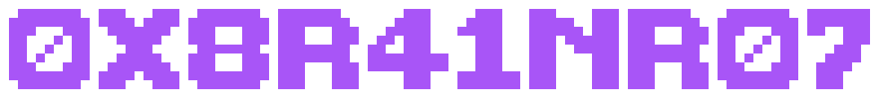

  

## `10` 🧠 ABOUT ME
Career-changer with a hacker's curiosity since 1984 (Commodore 64, Chaos Computer Club Hamburg) and 30+ years as a Creative Director, bringing systems thinking, stakeholder communication, and performance under deadline pressure into cybersecurity, where I apply analytical problem solving to dissect complex security incidents.

CompTIA Security+ certified, with hands-on practice in incident response (NIST SP 800-61), network design, and red-team recon exercises through MSIT's cybersecurity program.

Seeking a **SOC Analyst (L1)** role to build foundational blue-team experience en route to penetration testing and red teaming.

## `20` 🛠️ SKILLS &amp; TOOLS
**Focus:** incident response (NIST SP 800-61) · SIEM &amp; alert triage · detection engineering · web app pentesting (OWASP Top 10) · OSINT · network design &amp; segmentation · privacy hardening

  
  
  

<table>
  <tr><td><b>Blue team</b></td><td>  </td></tr>
  <tr><td><b>Red team</b></td><td>   </td></tr>
  <tr><td><b>Code</b></td><td>   </td></tr>
  <tr><td><b>Lab &amp; learning</b></td><td>     </td></tr>
</table>

## `30` 🔭 CURRENTLY WORKING ON
- **Sprint-30:** a 30-day hands-on cybersecurity sprint (SOC, detection engineering, AD attack/defence labs), documented on my blog
- **[VANISH](https://github.com/0x8R41NR07/vanish):** a Kali privacy-hardening script (Tor transparent proxy, MAC spoofing, DNS lockdown)
- **detection-lab:** detection rules and lab configs from the sprint (coming soon)

## `40` ✍️ WRITING — [BRAINDUMP](https://braindump.0x8r41nr07.xyz/)
- [From Hacker to Creative Director and Back](https://braindump.0x8r41nr07.xyz/series/fromhackertocreativedirectorandback): my journey, from the C64 days to agency life and back into security
- [Write-Ups](https://braindump.0x8r41nr07.xyz/series/writeups): pentest reports, OSINT and CTF walkthroughs
- [Blog](https://braindump.0x8r41nr07.xyz/series/blog): articles on security, AI and career change
- [Projects](https://braindump.0x8r41nr07.xyz/series/projects): my non-code projects

## `50` 🌐 CONTACT

  
  
  
  
  

---

`READY.`

<!-- Proudly created with GPRM ( https://gprm.itsvg.in ) -->
